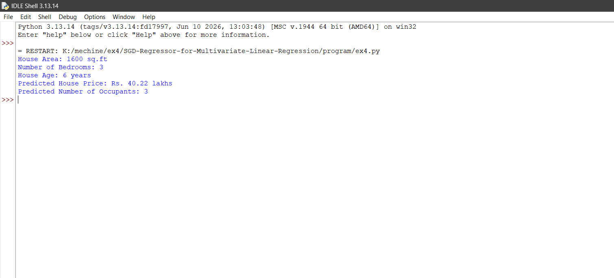

# SGD-Regressor-for-Multivariate-Linear-Regression

## AIM:
To write a program to predict the price of the house and number of occupants in the house with SGD regressor.

## Equipments Required:
1. Hardware – PCs
2. Anaconda – Python 3.7 Installation / Jupyter notebook

## Algorithm
1. Import the required libraries and create a dataset containing house features such as area, number of bedrooms, and number of occupants.
2. Separate the input features from the target variables and standardize the input features using StandardScaler.
3. Create and train an SGDRegressor model to predict the house price and another model to predict the number of occupants.
4. Provide new house details, predict the house price and number of occupants, and display the results.

## Program:
```

import numpy as np
from sklearn.linear_model import SGDRegressor
from sklearn.preprocessing import StandardScaler

# Dataset: Area (sq.ft), Bedrooms, House Age
X = np.array([
    [1000, 2, 5],
    [1500, 3, 10],
    [1800, 3, 8],
    [2000, 4, 5],
    [2500, 4, 2],
    [3000, 5, 1],
    [1200, 2, 12],
    [2200, 4, 4]
], dtype=float)

# Target 1: House price (in lakhs)
house_price = np.array([25, 35, 42, 50, 65, 80, 28, 58], dtype=float)

# Target 2: Number of occupants
occupants = np.array([2, 3, 4, 4, 5, 6, 2, 5], dtype=float)

# Standardize input features
scaler = StandardScaler()
X_scaled = scaler.fit_transform(X)

# Train the SGD Regressor for house price
price_model = SGDRegressor(
    max_iter=10000,
    tol=1e-4,
    random_state=42
)
price_model.fit(X_scaled, house_price)

# Train the SGD Regressor for number of occupants
occupant_model = SGDRegressor(
    max_iter=10000,
    tol=1e-4,
    random_state=42
)
occupant_model.fit(X_scaled, occupants)

# Input details of a new house
new_house = np.array([[1600, 3, 6]])
new_house_scaled = scaler.transform(new_house)

# Predict house price and occupants
predicted_price = price_model.predict(new_house_scaled)[0]
predicted_occupants = occupant_model.predict(new_house_scaled)[0]

# Display predictions
print("House Area:", new_house[0][0], "sq.ft")
print("Number of Bedrooms:", int(new_house[0][1]))
print("House Age:", int(new_house[0][2]), "years")
print("Predicted House Price: Rs.", round(predicted_price, 2), "lakhs")
print("Predicted Number of Occupants:", max(1, round(predicted_occupants)))

```

## Output:



## Result:
Thus the program to implement the multivariate linear regression model for predicting the price of the house and number of occupants in the house with SGD regressor is written and verified using python programming.